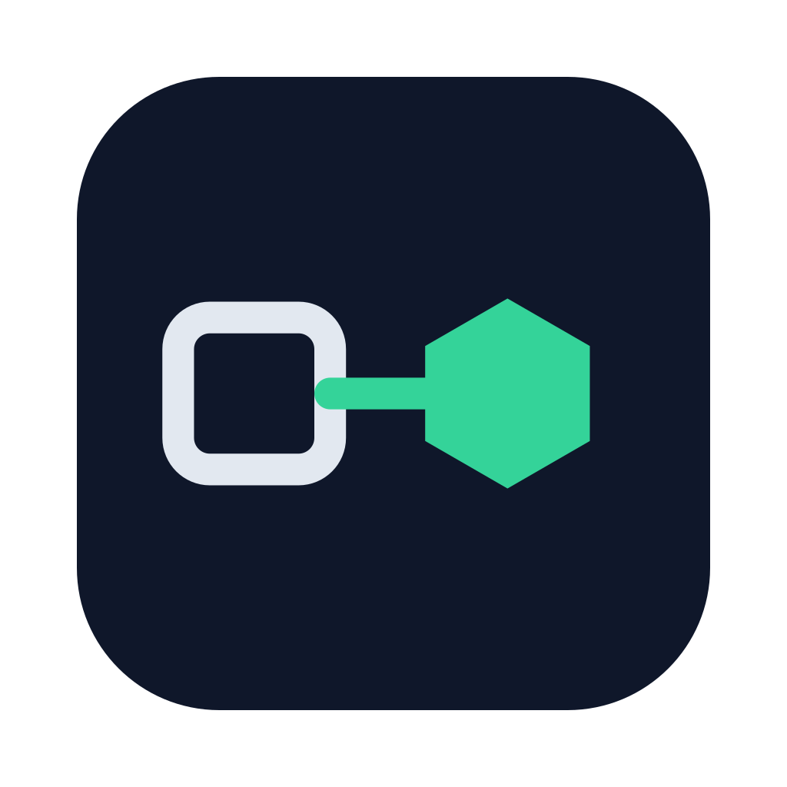

<p align="center"></p>

# Kubeport

[](https://github.com/deki-lab/k8s_forwarder/releases/latest)
[](https://github.com/deki-lab/k8s_forwarder/actions/workflows/ci.yml)
[](LICENSE)

[](https://www.buymeacoffee.com/lideke)

Kubernetes port-forwards from the macOS menu bar.

Set up a Forward once, turn it on with a switch, and forget about it: Kubeport follows the pods behind a Service, so a rollout or a crashed pod no longer breaks your `localhost` connection.

## Features

- **Lives in the menu bar**, in the style of the macOS Wi-Fi menu. No Dock icon, no window to manage.
- **Survives rollouts.** Target a Service: new connections move to another Ready pod as soon as the current one stops being Ready. `kubectl port-forward svc/…` dies with its pod.
- **One switch per Forward**, plus a master switch that turns everything off and back on.
- **Guided setup**: Context, namespace, Service or Pod and ports are listed from your cluster.
- **Auto-deactivate**: an unused Forward turns itself off after an idle timeout you choose.
- **Works with any kubeconfig**, including `exec` auth plugins (EKS, GKE, AKS, kubelogin). No `kubectl` needed.
- **Light**: about 17 MB of memory with 5 active Forwards.
- **English and French**, light and dark mode, following macOS.

## Install

```sh
brew install --cask deki-lab/tap/kubeport
```

Or download the `.dmg` from the [latest release](https://github.com/deki-lab/k8s_forwarder/releases/latest).

Requirements: macOS 14 or later, Apple Silicon.

The app is not signed with an Apple Developer ID yet, so macOS blocks it the first time:

1. Open Kubeport once, then close the alert.
2. Go to **System Settings › Privacy & Security**.
3. Click **Open Anyway** next to Kubeport, then confirm.

## Usage

Click the Kubeport icon in the menu bar.

- **New Forward…** creates a Forward: pick the Context, namespace, Service or Pod and remote port; the local port and the name are filled in for you.
- The **switch** on a row turns that Forward on or off. Click the row itself for details: Target, Resolved pod, address (with Copy), **Edit…** and **Duplicate…**.
- Active Forwards are listed first, grouped by Context · namespace. **Inactive Forwards ›** shows the others.
- The **Kubeport** switch at the top turns every Forward off, and brings the same ones back.
- **Kubeport Settings…**: open at login, default idle timeout, kubeconfig file, config file, quit.

Forwards that are on when you quit come back on at next launch. They listen on `127.0.0.1` only.

### Configuration file

Forwards are stored in `~/Library/Application Support/k8s_forwarder/config.toml`. You can edit it by hand, then use **Reload Config** in Settings:

```toml
idle_timeout = 60              # optional: default idle timeout in minutes

[[forward]]
name = "postgres-staging"
context = "staging"            # kubeconfig context
namespace = "db"
service = "postgres"           # or: pod = "postgres-0"
remote_port = 5432
local_port = 5432              # optional, defaults to remote_port
idle_timeout = "never"         # optional: minutes, or "never"
```

Editing from the app rewrites this file, so comments you add by hand are not kept.

## Support

If Kubeport saves you a few `kubectl port-forward` restarts, you can [buy me a coffee](https://www.buymeacoffee.com/lideke).

Bugs and ideas: [open an issue](https://github.com/deki-lab/k8s_forwarder/issues).

## Contributing

See [CONTRIBUTING.md](CONTRIBUTING.md) for building from source, tests and conventions.

## License

[MIT](LICENSE)
